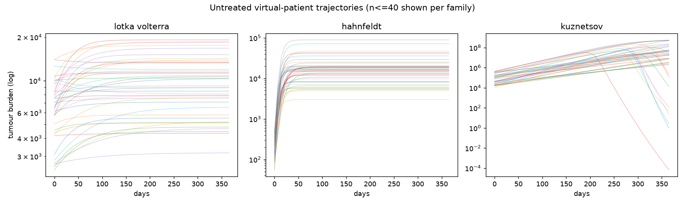
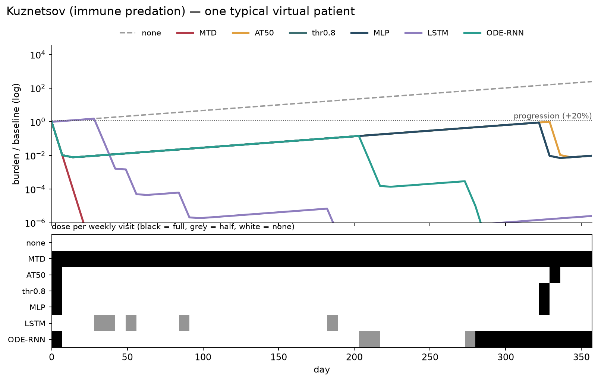
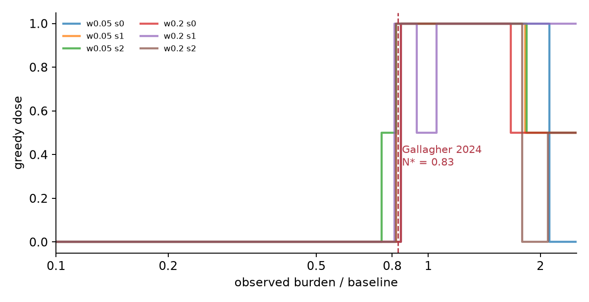
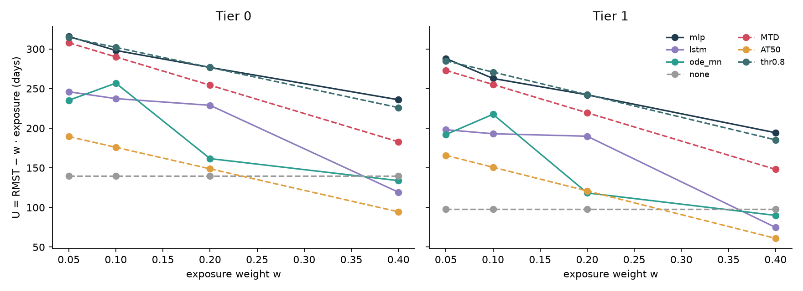
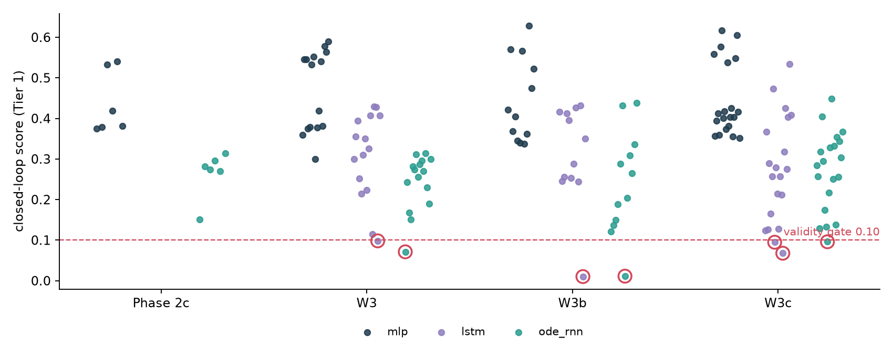

# Continuous-time RL for adaptive therapy — program report

**2026-09-24** · commit `8ef5296` · generated by `research/report.py`; result numbers are read from `research/outputs/` artifacts, earlier facts cite RESEARCH_LOG lines.

---

## 1. Summary

**Pre-registered answer so far: neither memory nor continuous time helps on this problem.** Phase 2c (L424) found the ODE-RNN progressing earlier than a memoryless MLP; W1 (L461) showed that gap exists without the shift. W3c (L565), the first valid three-arm run, orders the arms MLP > LSTM > ODE-RNN on the objective they were trained for, on both tiers, and the MLP only ties the one-line rule 'treat above 0.8 × baseline' that Gallagher 2024's RL also found. Along the way, four evaluation pitfalls were caught, each now a gate. Irregular observation (W4) is the remaining test.

## 2. Three tumour models

Lotka–Volterra (competition), Hahnfeldt (angiogenesis), Kuznetsov (immune predation). Families are separable from burden alone (0.996, L48) but θ is not identifiable. Only LV has untreated TTP dynamic range at weekly visits (L88).

## 3. Dosing regimes on each model (illustration)

none · MTD · AT50 (Zhang trial rule) · thr0.8 (Gallagher's learned switch) · the LV-trained MLP, LSTM and ODE-RNN, all through the same closed-loop rollout.

| model | none | MTD | AT50 | thr0.8 | MLP | LSTM | ODE-RNN |
|---|---|---|---|---|---|---|---|
| lotka_volterra | 120 d / 0 | 332 d / 357 | 206 d / 278 | 335 d / 259 | 334 d / 245 | 239 d / 166 | 328 d / 292 |
| hahnfeldt | 7 d / 0 | 7 d / 357 | 7 d / 357 | 7 d / 357 | 7 d / 357 | 7 d / 354 | 7 d / 294 |
| kuznetsov | 14 d / 0 | 357 d / 357 | 29 d / 10 | 29 d / 10 | 29 d / 10 | 115 d / 23 | 29 d / 108 |

*Restricted-mean TTP (capped 357 d) / median cumulative exposure, 100 patients per model.*

## 4. Phase 2c — the first valid comparison (L424)

ODE-RNN earlier / later per matched patient: **264 / 19** (w 0.05), **337 / 22** (w 0.20). Exposure ODE 194 vs MLP 280 — not matched. Kill criterion fired.

## 5. W1 — a training gap, not a robustness gap (L461)

On unshifted patients the ODE-RNN is still earlier in **164 / 174** untied pairs. The MLP is a switch at ~0.8 × baseline (≥ 94% of doses from the current reading).

## 6. W3 — memory vs continuous time (L496)

| comparison | Tier 0 gap | Tier 1 gap | overlap T1 | status |
|---|---|---|---|---|
| LSTM − MLP | -113 [-143, -55] | -182 [-233, -136] | 16% | INVALID |
| ODE − LSTM | +77 [+29, +99] | +22 [-41, +158] | 19% | INVALID |

Open-loop cells: `lstm_w0.4_s1` 0.098, `ode_rnn_w0.0_s0` 0.071

## 7. W3b — memory vs continuous time (L526)

| comparison | Tier 0 gap | Tier 1 gap | overlap T1 | status |
|---|---|---|---|---|
| LSTM − MLP | -28 [-41, -19] | -45 [-59, -40] | 52% | INVALID |
| ODE − LSTM | -8 [-12, +5] | -5 [-15, +12] | 1% | INVALID |

Open-loop cells: `lstm_w0.4_s4` 0.010, `ode_rnn_w0.2_s3` 0.011

## 7b. W3c — the first valid three-arm result (L565)

| comparison | Tier 0 Δ U | Tier 1 Δ U | status |
|---|---|---|---|
| LSTM − MLP | -73.5 [-78.1, -69.0] | -82.9 [-87.7, -78.0] | fail |
| ODE − LSTM | -16.7 [-21.3, -12.3] | -15.7 [-20.4, -10.8] | fail |

Mean U over w (days), Tier 1: mlp 246.8 · thr0.8 245.9 · MTD 223.9 · lstm 164.0 · ode_rnn 154.5 · AT50 124.6 · none 97.9

Excluded cells: `lstm_w0.1_s7`, `lstm_w0.2_s8`, `ode_rnn_w0.1_s8`

## 8. Validity across registrations

Closed-loop score per trained cell; below 0.10 a policy is effectively one fixed schedule.

## 9. Literature read to 1°

- **Gallagher et al. 2024** (Cancer Res, doi 10.1158/0008-5472.CAN-23-2040): RL on burden-only LV learns a switch at N* = 0.83 n₀ (Fig. 4B, p.1935); less frequent evaluation than training lowers TTP (Fig. 3C, p.1934).
- **Kiram et al. 2026** (arXiv 2605.02552): recurrent TD3 wins when a toxicity state is hidden, on one fixed patient, means over 10 seeds (Table I, p.5).

## 10. Next

1. Decide whether to promote the Tier 0/1 continuous-time negative to LAWS.md.
2. W4 — irregular observation, with an LSTM + Δt baseline.
3. W5 only if Hahnfeldt's day-7 resolution limit is fixed; W6 write-up.
