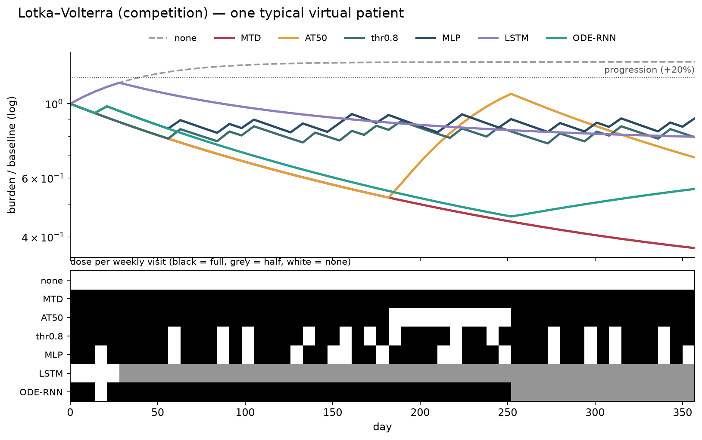
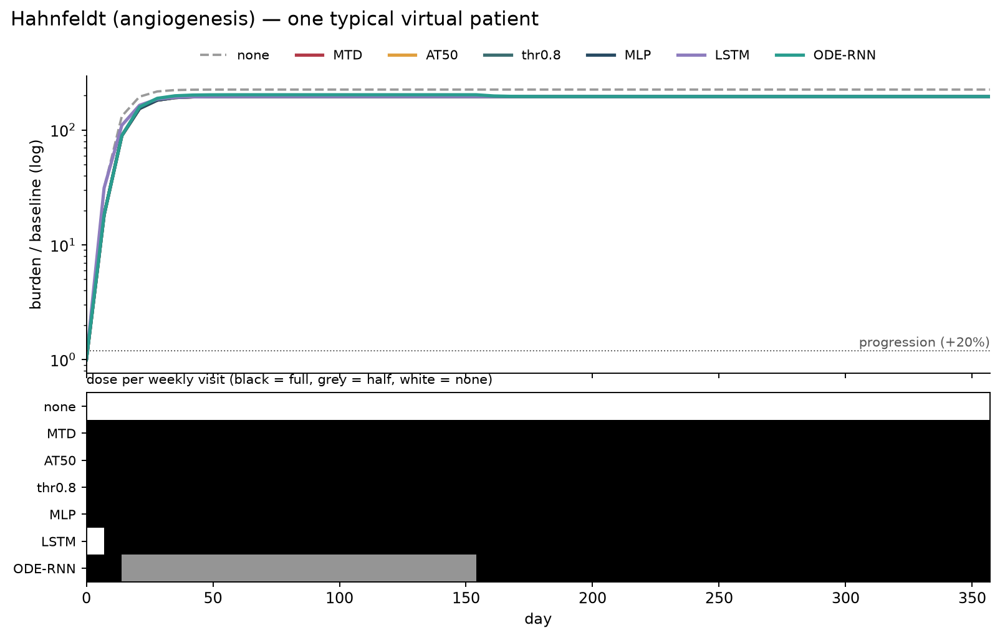
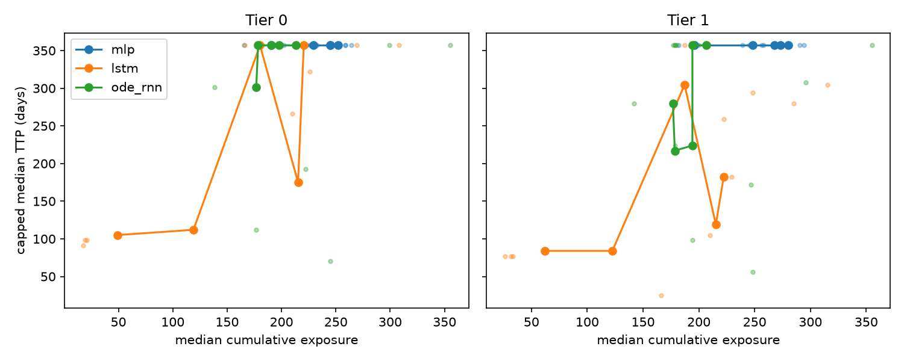
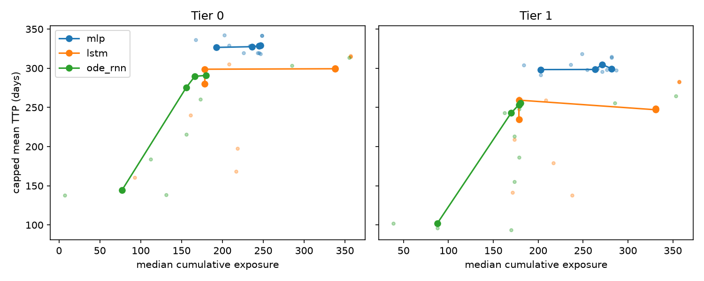
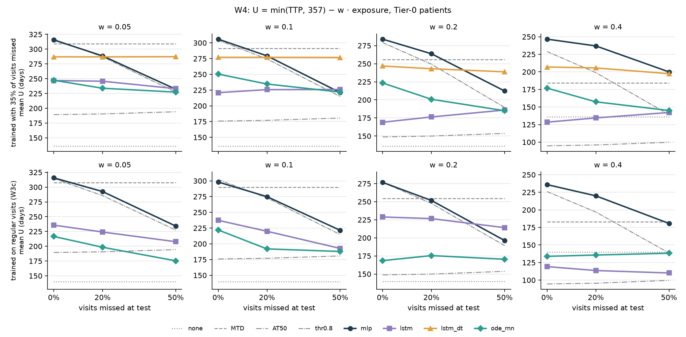
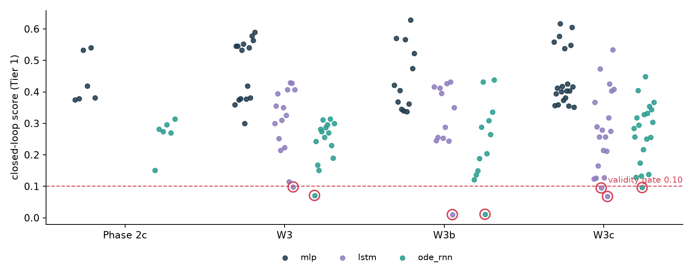

# Continuous-time RL for adaptive therapy — program report

**2026-09-27** · commit `9877d1e` · generated by `research/report.py`; result numbers are read from `research/outputs/` artifacts, earlier facts cite RESEARCH_LOG lines.

---

## 1. Summary

**Pre-registered answer so far: neither memory nor continuous time helps on this problem.** Phase 2c (L424) found the ODE-RNN progressing earlier than a memoryless MLP; W1 (L461) showed that gap exists without the shift. W3c (L565), the first valid three-arm run, puts the MLP above both recurrent arms on the objective they were trained for; resampling seeds as well as patients (L596), memory hurts but ODE-RNN vs LSTM spans 0, so the verdict is *no continuous-time edge*, not *worse* (LAW L1). The MLP only ties the one-line rule 'treat above 0.8 × baseline' that Gallagher 2024's RL also found. W4 (L632), missed visits, is INVALID: the recurrent arms learn near-fixed schedules, and at 50% missed visits full dosing (MTD) beats every learned policy.

### What was run, and what it showed

VOID = the run was broken; INVALID = an arm failed the pre-registered validity gate, so no architecture verdict; FAILED = valid, and the hypothesis lost.

| step | what was tried | status | what it showed | log |
|---|---|---|---|---|
| Phase 0 | 3 tumour models; can burden alone tell them apart? | PASSED | 0.996 balanced accuracy, but the margin is scale; θ not identifiable | L48 |
| Phase 1 | cohorts, TTP rule, solver | done | fixed-step solver is accurate; only LV has TTP range at weekly visits | L88, L166 |
| Phase 2 run 1 | ODE-RNN vs MLP, PPO, Tier 1 | VOID | test patients started above capacity; NaN rollouts scored as censored | L242 |
| Phase 2 run 2 | same, fixed cohort | FAILED | ODE-RNN gave every patient one schedule (4/6 cells): tested feedback vs fixed schedule, not architecture | L275, L312 |
| Phase 2b | fixed init + recurrent PPO | INVALID | 3/6 ODE-RNN cells still open-loop; MLP 6/6 closed-loop | L353, L391 |
| Phase 2c | switch trainer to PQN | FAILED (valid) | both arms closed-loop; ODE-RNN progresses earlier; kill criterion fired | L424 |
| W1 | diagnose on unshifted patients | diagnostic | the gap exists in-distribution; the MLP is a ≈0.8 × baseline switch | L461 |
| W2 | exposure-weight sweep replaces ±10% matching | method | built into W3's prereg; no run of its own | — |
| W3 / W3b | + LSTM arm; frontier, then RMST | INVALID ×2 | one open-loop cell voided a whole arm each time | L496, L526 |
| W3c | per-cell validity, 5 seeds, U = TTP − w·exposure | FAILED (valid) | MLP > LSTM; ODE ≈ LSTM once seeds are resampled | L565, L596 |
| W4 | 35% missed visits, + LSTM+Δt arm | INVALID | recurrent arms go near-open-loop and score higher that way; MTD wins at 50% missed | L632 |

## 2. Three tumour models

Lotka–Volterra (competition), Hahnfeldt (angiogenesis), Kuznetsov (immune predation). Families are separable from burden alone (0.996, L48) but θ is not identifiable. Only LV has untreated TTP dynamic range at weekly visits (L88).

## 3. Dosing regimes on each model (illustration)

none · MTD · AT50 (Zhang trial rule) · thr0.8 (Gallagher's learned switch) · the LV-trained MLP, LSTM and ODE-RNN, all through the same closed-loop rollout.

| model | none | MTD | AT50 | thr0.8 | MLP | LSTM | ODE-RNN |
|---|---|---|---|---|---|---|---|
| lotka_volterra | 120 d / 0 | 332 d / 357 | 206 d / 278 | 335 d / 259 | 334 d / 245 | 239 d / 166 | 328 d / 292 |
| hahnfeldt | 7 d / 0 | 7 d / 357 | 7 d / 357 | 7 d / 357 | 7 d / 357 | 7 d / 354 | 7 d / 294 |
| kuznetsov | 14 d / 0 | 357 d / 357 | 29 d / 10 | 29 d / 10 | 29 d / 10 | 115 d / 23 | 29 d / 108 |

*Restricted-mean TTP (capped 357 d) / median cumulative exposure, 100 patients per model.*

## 4. Phase 2c — the first valid comparison (L424)

ODE-RNN earlier / later per matched patient: **264 / 19** (w 0.05), **337 / 22** (w 0.20). Exposure ODE 194 vs MLP 280 — not matched. Kill criterion fired.

## 5. W1 — a training gap, not a robustness gap (L461)

On unshifted patients the ODE-RNN is still earlier in **164 / 174** untied pairs. The MLP is a switch at ~0.8 × baseline (≥ 94% of doses from the current reading).

## 6. W3 — memory vs continuous time (L496)

| comparison | Tier 0 gap | Tier 1 gap | overlap T1 | status |
|---|---|---|---|---|
| LSTM − MLP | -113 [-143, -55] | -182 [-233, -136] | 16% | INVALID |
| ODE − LSTM | +77 [+29, +99] | +22 [-41, +158] | 19% | INVALID |

Open-loop cells: `lstm_w0.4_s1` 0.098, `ode_rnn_w0.0_s0` 0.071

## 7. W3b — memory vs continuous time (L526)

| comparison | Tier 0 gap | Tier 1 gap | overlap T1 | status |
|---|---|---|---|---|
| LSTM − MLP | -28 [-41, -19] | -45 [-59, -40] | 52% | INVALID |
| ODE − LSTM | -8 [-12, +5] | -5 [-15, +12] | 1% | INVALID |

Open-loop cells: `lstm_w0.4_s4` 0.010, `ode_rnn_w0.2_s3` 0.011

## 7b. W3c — the first valid three-arm result (L565)

| comparison | Tier 0 Δ U | Tier 1 Δ U | status |
|---|---|---|---|
| LSTM − MLP | -73.5 [-78.1, -69.0] | -82.9 [-87.7, -78.0] | fail |
| ODE − LSTM | -16.7 [-21.3, -12.3] | -15.7 [-20.4, -10.8] | fail |

Mean U over w (days), Tier 1: mlp 246.8 · thr0.8 245.9 · MTD 223.9 · lstm 164.0 · ode_rnn 154.5 · AT50 124.6 · none 97.9

Excluded cells: `lstm_w0.1_s7`, `lstm_w0.2_s8`, `ode_rnn_w0.1_s8`

**Re-analysis resampling seeds as well as patients (L596).** The patient-only CIs above hold the trained policies fixed:

| comparison | Tier 0 Δ U | Tier 1 Δ U |
|---|---|---|
| LSTM − MLP | -73.5 [-100.3, -48.2] | -82.9 [-106.8, -58.7] |
| ODE − LSTM | -16.7 [-45.7, +24.2] | -15.7 [-43.0, +21.8] |

Training is chaotic: retraining `ode_rnn_w0.2_s7` under a 2e-7 float perturbation moved its mean U from 132 to 256 d.

## 7c. W4 — missed visits (L632)

A missed visit gives no observation and no decision; the last dose is held. Every arm trains with 35% of visits missed and is tested at 0 / 20 / 50%.

| arm | cells excluded (closed-loop < 0.10) | arm valid |
|---|---|---|
| mlp | 0/40 | yes |
| lstm | 10/40 | no |
| ode_rnn | 18/40 | no |
| lstm_dt | 21/40 | no |

Mean U over w (days), valid cells, by fraction of visits missed at test:

| policy | 0% | 20% | 50% |
|---|---|---|---|
| mlp | 288 | 267 | 216 |
| lstm | 191 | 196 | 197 |
| ode_rnn | 225 | 207 | 195 |
| lstm_dt | 254 | 253 | 250 |
| thr0.8 | 282 | 252 | 193 |
| MTD | 260 | 260 | 260 |
| AT50 | 152 | 153 | 157 |
| none | 136 | 136 | 136 |

Descriptive only (the recurrent arms are INVALID, so no verdict): ODE − X, mean over w and 20/50% missed, seed+patient CI: mlp -43 [-76, -4] · lstm +20 [-18, +52] · lstm_dt -17 [-50, +16]. Excluded recurrent cells score *higher* than the valid ones: with unreliable visits a fixed schedule can be the better policy, so the closed-loop gate cannot separate a training failure from a sensible choice. W4b must redefine validity first.

## 8. Validity across registrations

Closed-loop score per trained cell; below 0.10 a policy is effectively one fixed schedule.

## 9. Literature read to 1°

- **Gallagher et al. 2024** (Cancer Res, doi 10.1158/0008-5472.CAN-23-2040): RL on burden-only LV learns a switch at N* = 0.83 n₀ (Fig. 4B, p.1935); less frequent evaluation than training lowers TTP (Fig. 3C, p.1934). **Consistent with ours:** our MLP learned the same switch (≈ 0.80, L461), and missed visits lower every learned policy's score (L632). **Different:** their policy beats MTD and AT50 and tolerates ~1-month delays; ours only ties the 0.8 rule and loses to MTD at 50% missed. Setups differ (held dose vs delay, exposure-penalised U vs TTP, 3 dose levels vs on/off, means of one network vs seeds), so this is consistency, not validation.
- **Kiram et al. 2026** (arXiv 2605.02552): recurrent TD3 wins when a toxicity state is hidden, on one fixed patient, means over 10 seeds (Table I, p.5).

## 10. Next

1. W4b or not (owner's call): redefine validity under unreliable visits, e.g. MTD as a reference arm every candidate must beat — or write W4 up as it stands: at 50% missed visits a fixed schedule is competitive.
2. W5 only if Hahnfeldt's day-7 resolution limit is fixed; W6 write-up.
