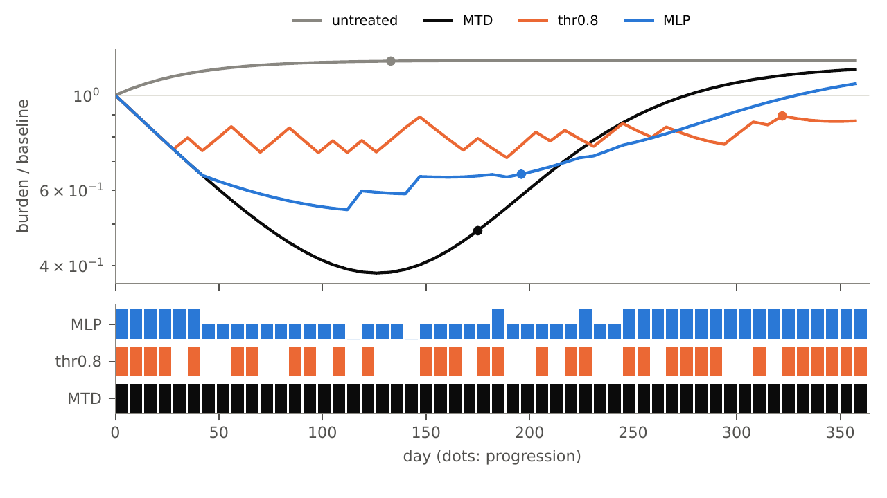
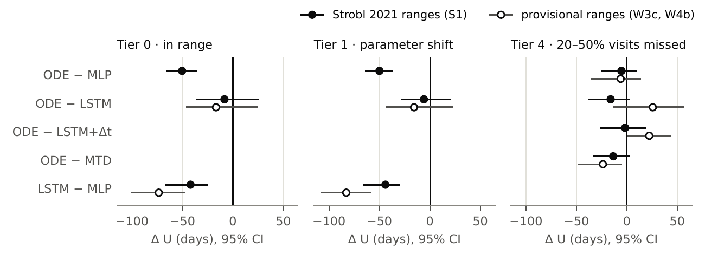
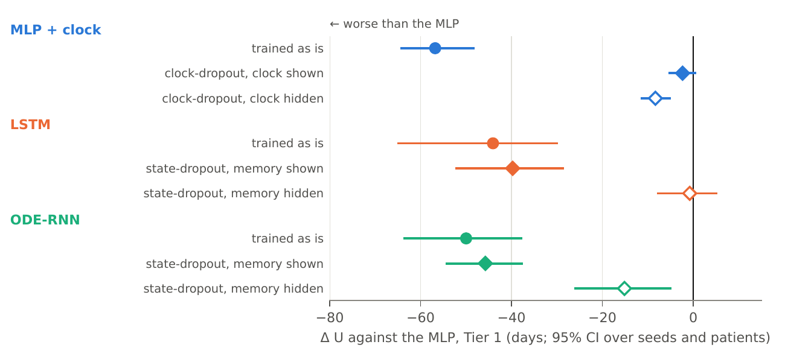

*Written for: a bioinformatician who knows a little reinforcement learning (RL) and wants the project explained from the start. Numbers are days of "score" on virtual patients (defined in section 2); every figure comes from a logged, pre-registered run.*

# 1. The short version

- **The question.** In adaptive therapy a drug is paused and restarted so that drug-sensitive tumour cells stay alive and compete with resistant ones. We ask whether an RL policy that *remembers* past tumour measurements, or that models time as a continuous flow (an "ODE-RNN"), schedules the drug better than a trivial policy that looks only at today's measurement.
- **The answer, in our simulator: no.** A memoryless network that has learned "treat when the tumour is above about 80% of its starting size" matches or beats both the recurrent network (LSTM) and the ODE-RNN. The ODE-RNN is about 50 days worse than the simple network and statistically indistinguishable from the LSTM. This holds in range, under a parameter shift, and with missed visits.
- **It is not because there is nothing to gain.** A per-patient search on the true simulator beats the simple network by 23 days. But a split of that gain shows only about 15 days need memory-type information, while training the recurrent networks costs 40 to 50 days.
- **The most interesting finding is a training shortcut.** Giving the simple network a clock costs it 57 days, and hiding the clock half of the time during training removes the whole cost. The same trick does not rescue the recurrent networks.
- **Three objections have been tested** (a trainer that cannot use memory; a network too small; a single training algorithm): see sections 6 and 7.
- **Where it stands.** A TMLR-formatted paper (12 pages) is built and every claim in it traces to a pre-registered run. It has not been submitted. The venue is TMLR (rolling, double-blind, judged on whether the claims are supported, not on novelty).

# 2. Background for a newcomer to RL

**Adaptive therapy.** Maximum tolerated dose (MTD) kills sensitive cells and lets resistant ones take over. Adaptive therapy treats until the tumour has shrunk, pauses, and restarts when it regrows, so sensitive cells keep suppressing the resistant ones. The usual clinical rule is a threshold on a blood marker such as PSA.

**The RL set-up.** A *policy* is a function that reads what we can observe and outputs a dose (none, half or full). It is trained by trial and error on *virtual patients*: a two-population Lotka-Volterra model (sensitive S and resistant R cells competing for space) whose parameters we sample for 200 training and 200 test patients. Visits are weekly for one year (52 decisions). Training rewards low tumour burden and charges for drug, with an exposure price w we vary over four values.

**Why it is hard: partial observation.** The policy sees only the *total* tumour burden, with 5% noise, never S and R separately. This makes the problem a *partially observable* one: the same measurement can hide different underlying states. The textbook fix is *memory*: a network that carries a summary of the past.

**The networks compared.**

| Network | What it does | Plain-language role |
|---|---|---|
| MLP | looks only at today's measurement | the memoryless baseline |
| Positional MLP | today's measurement plus a clock | tests whether knowing the time is enough |
| LSTM | recurrent network, remembers the past in discrete steps | standard memory |
| ODE-RNN | the hidden memory evolves as a differential equation between visits | the "continuous-time" candidate |

All were trained with the same algorithm (PQN, a recent simple Q-learning method) and matched in size (about 3,100 parameters), so that only the architecture differs.

**The score.** For each patient, U = (days until progression, capped at the 357-day horizon) minus w times the drug given. Progression is a 20% rise above the lowest burden reached, confirmed over 28 days. Differences between two networks are *paired* (same patients) and the 95% interval is a bootstrap over both training seeds and patients. Positive favours the first network.

{width=90%}

*How to read this figure.* The top panel is the tumour size relative to its starting size (logarithmic axis) over one year; each line is one dosing policy and the grey line is no treatment. A dot marks progression. The bottom panel has one bar per week for each policy: a tall bar is a full dose, a short bar a half dose, a gap means no drug. The patient is the one whose drug saved by the MLP against MTD is the median over the patients where it saves any (a fixed rule, not a hand pick).

# 3. Methods in detail

**The decision problem, stated as a POMDP.** Everything below fills in the pieces of this tuple $(\mathcal{S},\mathcal{A},P,R,\Omega,O,\gamma,T)$; the tumour equations are only the transition function $P$.

| Piece | Definition here |
|---|---|
| Hidden state $s_t$ | $(S_t,\,R_t,\,C_t,\,\theta)$: sensitive cells, resistant cells, drug concentration in the single PK compartment, and the patient's parameters (growth rates, turnover, capacity, initial fill). The policy never sees any of it, and neither does it see the running lowest burden that the reward and the score use. |
| Action $a_t$ | One dose from $\{0,\tfrac12,1\}$, chosen at visit $t$ and held for 7 days. |
| Transition $P$ | The dose is added to $C_t$ as a bolus, then the tumour ODE is integrated for 7 days (fixed-step solver) with $C$ cleared at 0.5 per day. The dynamics are deterministic given $\theta$; all randomness is in the initial patient and the measurement noise. |
| Initial state | A patient drawn by Latin hypercube from the regime's ranges (200 for training, 200 for testing, per seed), with no drug on board. |
| Observation $o_t$ | $\log\big((S_t+R_t)/(S_0+R_0)\big)$ plus 5% log-normal noise: one number per visit. At Tier 4 a missed visit gives no observation and no decision, and the last dose continues. |
| Reward $r_t$ | $-\max(b_t/b_{\min,t}-1.2,\,0)\;-\;w\cdot a_t$ plus a constant paid every visit, where $b_t=S_t+R_t$ and $b_{\min,t}$ is the lowest burden so far. $w\in\{0.05,0.1,0.2,0.4\}$; one network per $w$. |
| Horizon and discount | Fixed: 52 visits (357 days), no early termination, $\gamma=0.99$. |
| Policy and objective | A network $\pi(a_t\mid o_{1:t})$ that sees the history of observations only (for the MLP, the last one). Training maximises expected discounted reward; the reported score is $U=\min(\mathrm{TTP},357)-w\cdot\text{exposure}$ per patient. |

Two consequences matter for the rest of the report. The reward and the score are close but not identical: the reward penalises burden above $1.2\times$ the nadir at every visit, while $U$ counts days to a *confirmed* progression, so a policy is trained on a proxy for what it is scored on. And because $S$ and $R$ are hidden, total burden alone is ambiguous: a falling burden can mean sensitive cells dying with resistant ones already dominant, which is why memory could in principle help.

**The patient model.** Each virtual patient has two cell populations that compete for the same space (a Lotka-Volterra model):

- sensitive cells S grow at rate $r_S$, are killed by the drug (strength $d_D$ times the drug effect u), and die naturally at rate $d_S$;
- resistant cells R grow at rate $r_R$ (usually slower, the "cost of resistance") and are not affected by the drug;
- both are slowed as the total S + R approaches a shared capacity K.

The drug effect u comes from a minimal pharmacokinetic model: each dose is a bolus that is cleared at 0.5 per day, and its effect saturates (an $E_{max}$ curve with half-effect level 0.5). The only thing the policy sees is the *total* S + R, as a ratio to its starting value, on a log scale, with 5% log-normal measurement noise.

**Where the parameters come from.** The primary regime follows the ranges of Strobl et al. (2021): $r_S$ = 0.027 per day, $r_R$/$r_S$ between 0.5 and 1, turnover $d_S$ = $d_R$ between 0 and 0.5 $r_S$, drug strength 1.5, initial fill $n_0$ between 0.1 and 0.75 of capacity, initial resistant fraction between 0.1% and 10%. Fed these parameters, our implementation reproduces all 14 of that paper's published progression times and adaptive-therapy gains that we checked, within 3%. A second regime with a stronger cost of resistance (median $r_R$/$r_S$ = 0.30) is reported separately. Each patient is one Latin-hypercube sample of these ranges: 200 for training and 200 for testing, per seed.

**Time, and how long an episode lasts.** Time is in days. One *episode* is one year: 52 weekly visits, which is 357 days. At each visit the policy sees one measurement and picks one dose (none, half, full) that is held for the next 7 days; between visits the model equations are integrated with a fixed-step solver (accurate to about $10^{-4}$). The ODE-RNN's hidden state evolves in steps of 7/8 of a day between visits. Every episode runs the full 52 visits; progression is scored afterwards from the burden curve (the score keeps the patient's time to progression, capped at 357 days).

**What the policy is rewarded for.** At each visit the training reward is minus how far the burden is above 1.2 times its lowest value so far (zero if it is below), minus w times the dose, where w is the exposure price (0.05, 0.1, 0.2 or 0.4). A separate network is trained for each price. The reported score U adds up the outcome that matters: days to progression minus w times the drug given.

**Training.** All networks use the same trainer, PQN (a Q-learning method with no replay memory and parallel patients), with its published settings except the number of parallel patients: 300 updates, each on 32 training patients, 4 epochs, learning rate 3 x $10^{-4}$ decaying to zero, discount 0.99. Exploration starts fully random and falls to 0.5% over the first 10% of updates. The networks' sizes are matched at about 3,100 parameters so that only the architecture differs. Each configuration is trained with 10 different random seeds. Nothing is tuned per architecture.

**Testing.** Trained policies are run greedily on the 200 held-out patients in three settings: Tier 0 (parameters inside the training ranges), Tier 1 (growth rates scaled by 1.5 and carrying capacity by 0.6, outside the training ranges), and Tier 4 (each visit is missed at random with probability 20 to 50%; a missed visit gives no measurement and the last dose simply continues). Time to progression is a 20% rise above the lowest burden reached, confirmed over 28 days.

**Statistics.** Differences in U are paired by patient, averaged over the four exposure prices, and the 95% interval is a bootstrap that resamples both seeds and patients (resampling only patients made the intervals falsely narrow). Every cell counts: failed or collapsed runs are kept, not removed. Each experiment's hypothesis, pass criterion and kill criterion were written to a registration file before it ran; analyses chosen afterwards are labelled post hoc.

**What the simulator cannot do.** It models one disease mechanism (resistance by competition), is calibrated to published ranges rather than to individual patients, has a one-year horizon in the main results, and gives the policy only weekly noisy burden measurements. Section 8 lists the consequences.

# 4. What we found

{width=100%}

*How to read this figure.* Each row compares two networks (for example "ODE − MLP"). The dot is the average difference in score, in days, over the test patients; the line is its 95% interval. A dot to the right of the zero line means the first-named network is better; to the left, worse; a line that crosses zero means we cannot tell them apart. Filled dots use the main simulator ranges (Strobl 2021), open dots a second, higher-cost regime. No ODE-RNN row lies to the right of zero.

1. **No continuous-time edge.** ODE-RNN minus MLP is -50.0 days [-63.5, -37.9] under the parameter shift, and ODE-RNN minus LSTM is -5.9 [-27.9, +19.9] (no difference). With missed visits ODE-RNN minus MLP is -5.4 [-24.3, +9.3], and the ODE-RNN is never above a fixed-schedule MTD rule. The ODE-RNN's only advantage appears at 50% missed visits and comes from giving more drug.
2. **The memoryless threshold is hard to beat.** The trained MLP learns a threshold near 0.8 times baseline burden and ties the one-line rule that does the same. Recurrent networks react less to today's measurement and earn lower training reward than the MLP: they are harder to train, not better at the task.
3. **There is headroom, and memory is a small part of it.** A search on the true simulator beats the MLP by +23.1 days [+20.3, +25.8]; a threshold tuned per patient does +26.0. That gain splits roughly in thirds: about 11 days is a better fixed threshold the MLP could represent but did not learn, about 9 days is seeing the burden exactly instead of with noise, and about 7 days is knowing the patient's best level. Only the last two need memory-type information, at most about 15 days. This is a split of one rule family's gain, not a proof that no memory policy could help.
4. **Models fitted to 55 real prostate-cancer patients' PSA data replicate both negatives** (appendix of the paper; low statistical power because MTD controls these patients for a year).

# 5. The training-shortcut result

{width=85%}

*How to read this figure.* Same layout as the previous figure, but every row is compared with the plain MLP (the zero line), in the shifted-parameter setting. Colour is the network type. A round dot is a network trained normally; a filled diamond is one trained with the clock (or memory) hidden half the time; an open diamond is the same network with the clock or memory also switched off at test time. A dot near zero means "as good as the MLP".

The positional MLP (MLP plus clock) is 56.8 days worse than the MLP. If we hide the clock in half of the training episodes it recovers fully (+54.4 days, so it ties the MLP at -2.4 [-5.2, +0.4]). The deficit was the trainer fitting a time-keyed schedule instead of reacting to the tumour. The same treatment applied to the LSTM and ODE-RNN (hiding their memory half the time) changes little (+4.3 and +4.2 days, intervals spanning zero), and both stay 40 to 46 days below the MLP. When their memory is switched off at test time they do 31 to 39 days *better*: they use their memory in a way that hurts.

# 6. Controls added after review

Two outside reviews of the paper made the same three points, so we ran them:

| Objection | Run | Result |
|---|---|---|
| "Maybe PQN cannot train any recurrent network" | W10: same trainer, three POPGym memory tasks | The LSTM beats the MLP on 2 of 3 tasks (return +1.38 and +1.04 on a scale where +1 is perfect). So the trainer can use memory where memory pays. |
| "The LSTM is just too small" | V11: LSTM with 5 and 22 times the parameters | No recovery (-5.1 and -3.1 days against the small LSTM, intervals wide); still 47 to 49 days below the MLP. |
| "A single training algorithm" | V12: all arms retrained with PPO | Inconclusive: the validity check failed (section 7). |
| "Is the visit timing informative?" | W8, W9: next visit time given to the network | Not testable: the manipulation checks failed, so nothing was closed. |

# 7. Second training algorithm (V12)

We repeated the main comparison with PPO, the other widely used RL algorithm, instead of PQN (600 updates, untuned, every network retrained).

**The test did not pass its own validity rule, so it tells us nothing about the trainer.** Before running it we required that a network shown the *true* hidden cell counts must beat the ordinary MLP under the new algorithm; otherwise the algorithm cannot make use of extra information on this task and a comparison under it is uninformative. It did not (difference -1.6 days, interval -10.4 to +5.6).

What we can say descriptively, without drawing a conclusion: under PPO the LSTM and ODE-RNN again score 28 to 42 days below the MLP and are tied with each other, and in 12 (LSTM) and 22 (ODE-RNN) of 40 training runs they collapse to a fixed full-dose schedule that ignores the tumour. That collapse is the same failure we saw in our very first experiments and list among the paper's four evaluation errors.

Consequence: the paper reports this run as inconclusive and does not claim the result holds under two training algorithms. A second algorithm for which the full-information check passes is still missing.

# 8. Limitations (honest list)

- One simulator family (Lotka-Volterra), virtual patients, no clinical claims. Other model families could not be used (Hahnfeldt and Kuznetsov have no resistance; the published Zhang 2017 and Phan 2019 models did not reproduce).
- One training algorithm for most results, with published settings, untuned; the recurrent networks are unstable across seeds, which we count as part of their cost.
- The ODE-RNN uses fixed 7/8-day steps and visits are weekly, so missed visits carry no timing information; this limits what a continuous-time model could show.
- The MLP and ODE-RNN were not scaled in the capacity check.
- Some analyses are post hoc (marked in the paper's table of runs).

# 9. Next steps

1. A second training algorithm that passes the full-information check (the open item both reviewers care about most); this needs a new idea, not a re-tune.
2. Optional: a tighter bound on headroom (better optimiser) so the "23 to 26 days" is a true optimum; a matched-large MLP.
3. Prose trimming, an anonymised code link, a final check of references, then submission to TMLR.

# Glossary

**Adaptive therapy** pause-and-restart dosing. **ODE-RNN** a recurrent network whose hidden state flows according to a learned differential equation between observations. **LSTM** the standard recurrent network. **MTD** maximum tolerated dose. **PQN / PPO** two RL training algorithms. **POMDP** partially observable decision problem. **TTP** time to progression. **Pre-registration** the hypothesis and pass/kill rule are written down before the run. **Seed** one independent training run. **Tier 0 / 1 / 4** in range / parameters shifted outside the training range / visits randomly missed.
